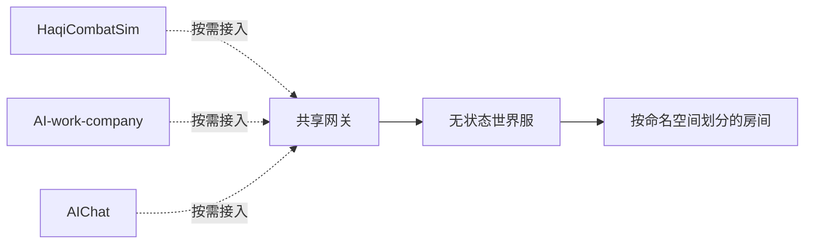

# HaqiGameServerLite

通用私有账号房间使用 `roomType:"account"` 与 `account.relay.v1`，任意应用可独立演进payload协议；服务器只认证、隔离及中继。参见 [私有房间协议](docs/private-rooms.md) 与部署记录。

供 **HaqiCombatSim、AI-work-company 和 AIChat** 共用的轻量在场服务器。网关分配实例，世界服同步玩家外观、房间和移动，管理页查看状态并调整实例。无运行时第三方依赖，不依赖任一业务项目的源码或构建产物。

当前只提供临时在场状态，不保存账号、业务数据或战斗结果。三个项目的正式页面尚未接入；迁出服务器不会自动改变客户端行为。

## 启动和验证

需要 Node.js 22.12 或更新版本。克隆后无需安装依赖即可运行：

```sh
git clone https://github.com/LiXizhi/HaqiGameServerLite.git
cd HaqiGameServerLite
npm start
```

默认网关：`http://127.0.0.1:8797`，管理页：`http://127.0.0.1:8797/admin`，首个世界服：`ws://127.0.0.1:8798`。避开 AI-work-company 已使用的 8787 端口；可用环境变量覆盖。VS Code 打开本仓库后运行迁入的任务 **haqi server: start**；多文件夹工作区把本仓库作为独立文件夹加入即可。

```sh
npm test             # 协议、网关、WebSocket、重启和共享客户端回归
npm run test:load    # 8000 玩家容量与真实连接测试
npm run test:all     # 全部测试
npm run dev          # Node watch 模式
```

`.env.example` 列出配置；默认不会自动读取 `.env`。需要文件配置时复制为 `.env`，执行 `node --env-file=.env src/presence/index.js`。管理口令只存环境变量，不写入客户端。

## 结构与共享接入

```text
src/presence/             服务入口、协议、通用房间配置
src/presence/gateway/     HTTP 网关、负载分配、中文管理页
src/presence/gameserver/  无状态世界服、实例与房间
src/presence/client.js    浏览器 / Node 共用 ES module 客户端
tests/                   功能和容量测试
docs/                    协议及接入说明
.vscode/tasks.json       启动与测试任务
```

三个项目共用同一网关，通过项目命名空间避免房间和玩家标识碰撞；有意跨项目互动时使用共同命名空间。详见 [共享接入](docs/integration.md) 和 [协议与运行机制](docs/protocol.md)。



服务默认仅绑定本机。当前玩家 ID 由客户端声明，命名空间不是权限隔离；注册、心跳等控制接口也尚无完整认证。公网部署前需补齐身份认证、控制面访问限制、TLS 和可达的世界服地址配置。不要将开发端口直接公开到互联网。

## 来源

当前 US 服务器、域名、访问地址和运维信息见 [部署记录](docs/deployment.md)。

2026-10-23 从 `LiXizhi/HaqiWebTools` 的 `HaqiCombatSim/server/presence/` 迁入，服务器测试与 VS Code 启动任务一并迁移。新仓库是后续服务端维护入口；前端项目各自维护业务数据与 UI。

## 用户分析

`npm start` 默认每分钟采样并按北京时间生成每日日报，管理页输入管理口令后查看在线图、活跃、留存和前一天／上周同日对比。统计数据保存在独立分析目录，游戏业务档案仍不保存在世界服。详见 [用户日报与统计口径](docs/analytics.md)。
